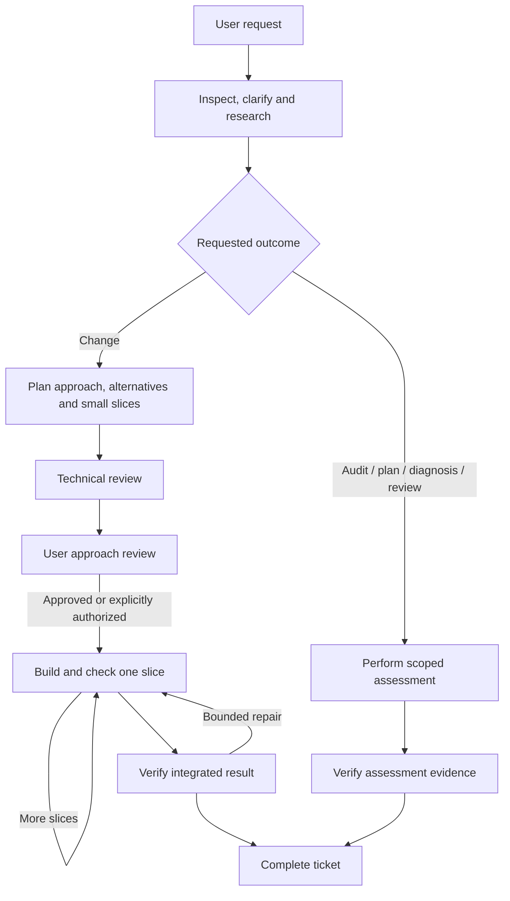

# Forge workflow

Describe an outcome to `ae-forge`. It owns one local ticket throughout.

Discovery questions concern intended behavior, scope and constraints. Current
documents are checked against relevant source and the identified running
build. Contradictions become explicit decisions; unresolved intent is not
silently treated as stale documentation.

For emulator audits, discover the installed tool's actual capabilities and
confirm device/app/build identity. Account for requested screens and states:
inspected, inaccessible or explicitly excluded. Link visual evidence to source
and the agreed design baseline. Audit-only requests cannot authorize fixes.

## One human ticket

`.dev/runs/<id>.md` shows status, recorded current owner, now, concrete progress,
blockers, next action, approach/alternatives, checklist and evidence links.
It is generated from accepted records; handoffs carry the original requirements
and relevant evidence rather than just this compact view.

Default delivery stops at approach review before application edits. The user
can question alternatives or request a revision. Explicit autonomy or earlier
approval of the same approach is reused. After approval, routine slices and
bounded repairs proceed; material design/scope changes return for review.

The same ticket moves to `.dev/completed/` with outcome, verification and
limits. Frozen accepted requirements, immutable worker results and a compact
recovery record stay local and ignored. The human ticket is never the source
of review hashes or permission.

## Methods and host capabilities

Keep one entry point. Internal stage skills expose planning, implementation,
verification, diagnosis and audit methods to Forge. Role names identify
accountability, not an organization chart. Selected lenses carry domain checks.

Use native host delegation where available and authorized. Otherwise run
methods sequentially and report same-session review honestly. Keep workflow
mechanics separate from host execution; hook checks are not a sandbox.

See [Forge](../skills/ae-forge/SKILL.md), its
[shared contract](../skills/ae-forge/references/team.md), and
[recording commands](../skills/ae-forge/references/commands.md).
